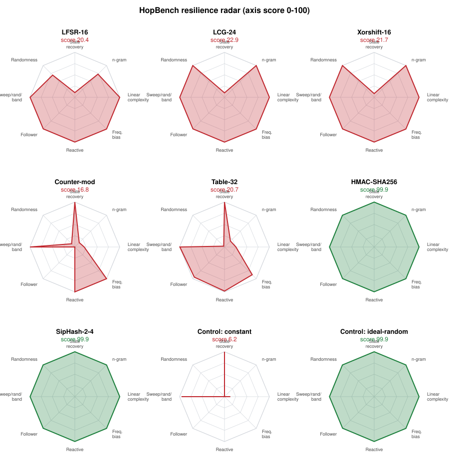
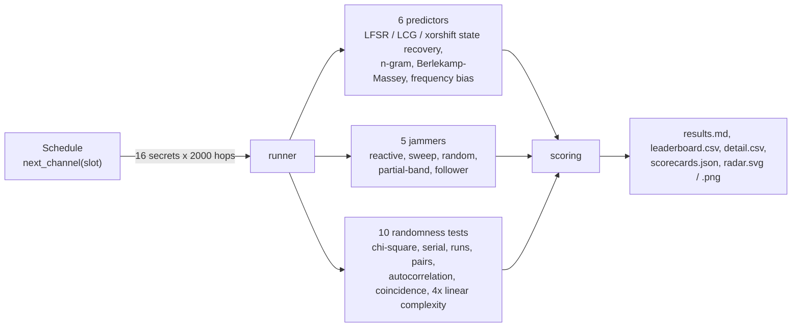
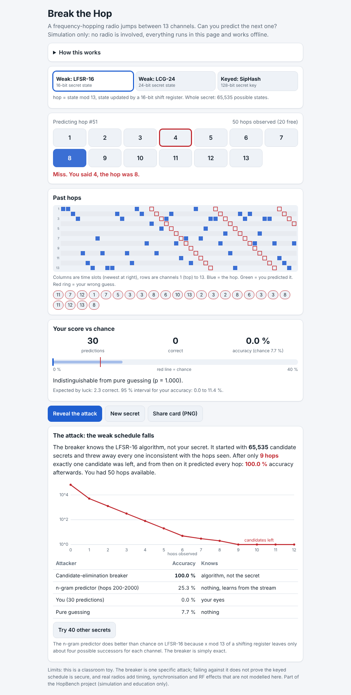
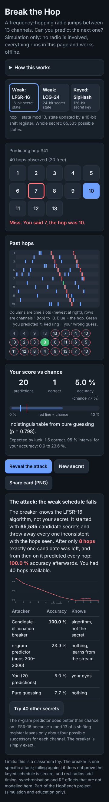

# HopBench

**A benchmark that grades frequency-hop schedules against a fixed suite of simulated attackers, and a browser game that lets you feel why a 16-bit LFSR is not a secret.**

[](https://github.com/Kavin-Re/HopBench/actions/workflows/ci.yml)


> **Scope.** Simulation and education only. Nothing here transmits, receives or jams RF. Every
> schedule and attacker is a generic textbook scheme implemented in this repository.
> A HopBench score is relative to this attacker suite. It is **not** a security proof.

A frequency-hopping radio is only as hard to follow as its hop schedule is hard to predict.
HopBench answers one narrow question: *if an attacker knows the algorithm and watches the hops,
how quickly can they predict the next channel?* It runs eleven attackers and ten statistical
tests against each schedule, over many independent secrets, and reduces the outcome to a 0-100
scorecard with confidence intervals.



## Headline result

Reference run: 13 channels, 16 secrets per schedule, 2000 slots per attack. Full tables are in
[`results/results.md`](results/results.md).

| # | Schedule | Score | Broken by | Hops observed before the break (median) |
|---|---|---:|---|---:|
| 1 | SipHash-2-4 (128-bit key) | 99.9 | nothing in this suite | - |
| 2 | HMAC-SHA256 (256-bit key) | 99.9 | nothing in this suite | - |
| 3 | LCG-24 | 22.9 | state recovery | 6 |
| 4 | Xorshift-16 | 21.7 | state recovery | 5 |
| 5 | Table-32 (secret table, repeated) | 20.7 | n-gram model / Berlekamp-Massey | 34 / 128 |
| 6 | LFSR-16 | 20.4 | state recovery | 8 |
| 7 | Counter-mod (`a*t + b mod M`) | 16.8 | n-gram model / Berlekamp-Massey / follower jammer | 14 / 52 |

Calibration controls: a constant channel scores 6.2 and an i.i.d. uniform stream scores 99.9.

Two things in that table are the point of the project:

- **Passing randomness tests is not the same as being unpredictable.** LCG-24 and Xorshift-16
  pass all ten tests of the battery in every trial, and an attacker that knows the generator
  still recovers the state from 5 to 6 observed hops, after which it predicts every hop.
- **The keyed schedules are indistinguishable from the random control *for these attackers*.**
  That is the most a benchmark can say. Their real strength rests on the cryptographic
  assumptions behind HMAC-SHA256 and SipHash, not on this score.

## How it works



**Threat model (Kerckhoffs).** The attacker knows the algorithm and all parameters, observes
every past hop without error, and does not know the seed or key. Each slot the attacker commits
to a set of channels to jam *before* the hop is revealed.

| Module | Role |
|---|---|
| [`hopbench/schedules.py`](hopbench/schedules.py) | `Schedule` interface, seven built-in schedules, two controls |
| [`hopbench/attackers.py`](hopbench/attackers.py) | the eleven attackers |
| [`hopbench/randtests.py`](hopbench/randtests.py) | randomness battery (p-values, fail at alpha = 0.001) |
| [`hopbench/stats.py`](hopbench/stats.py) | incomplete gamma, bootstrap and Wilson intervals, online Berlekamp-Massey, exact linear-complexity distribution (no SciPy) |
| [`hopbench/runner.py`](hopbench/runner.py) | experiment loop, loss model, parameters (`SuiteConfig`) |
| [`hopbench/scoring.py`](hopbench/scoring.py) | per-attacker scores, axes, weakest-link gate |
| [`hopbench/report.py`](hopbench/report.py) | Markdown / CSV / JSON / radar writers |
| [`break_the_hop/index.html`](break_the_hop/index.html) | single-file browser game, no dependencies, works offline |

### The attackers

| Attacker | Kind | What it does |
|---|---|---|
| LFSR-16 breaker, LCG-24 recovery, Xorshift-16 breaker | predictor | Candidate elimination: keeps every internal state consistent with the hops seen so far. One candidate left means every future hop is known. |
| n-gram / Markov | predictor | Order-3 context model with back-off. Learns tables, strides and short periods. |
| Berlekamp-Massey | predictor | Fits the shortest GF(2) LFSR to each bit plane of the channel index and predicts when the linear complexity is low. |
| Frequency bias | predictor | Guesses the most-used channel so far. |
| Reactive (delay 1) | jammer | Jams the channel used one slot ago. |
| Sweep, Random | jammer | One channel per slot, stepped or uniform. |
| Partial-band | jammer | A 4-channel block that relocates every 250 slots. |
| Follower | jammer | Extrapolates the last hop step and jams that channel and both neighbours. |

## Quick start

```bash
git clone https://github.com/Kavin-Re/HopBench.git && cd HopBench
python -m pip install -r requirements.txt      # numpy (+ matplotlib for the optional PNG radar)

python -m hopbench list                        # the built-in schedules
python -m hopbench run --quick --out out       # reduced run: 6 secrets, 800 slots
python -m hopbench run --out results --jobs 4  # the reference run behind results/ (about a minute)
```

Requires Python 3.10 or newer (CI runs 3.10 and 3.13).

### Grade your own schedule

Subclass `Schedule`. The constructor receives `(M, seed)`, where `seed` stands for the secret of
one deployment; HopBench instantiates it with many different seeds.

```python
# examples/custom_schedule.py
from hopbench import Schedule

class WeakCounter(Schedule):
    name = "Example: stride-5"
    def next_channel(self, slot):
        return (5 * slot + int(self.seed)) % self.M
```

```console
$ python -m hopbench score examples.custom_schedule:HashOfCounter examples.custom_schedule:WeakCounter --quick
Example: SHA256-counter  score  99.9  (no weakness found by this suite)
Example: stride-5        score  17.8  (broken)
Control: ideal-random    score  97.7  (no weakness found by this suite)
```

The ideal-random control is always graded alongside your schedule so you can see the ceiling for
that run. `--quick` uses few trials, so the ceiling itself moves by a couple of points (97.7 here).

A custom generator has no dedicated state-recovery attacker, so its score is an **upper bound**.

### Break the Hop (browser game)

Open [`break_the_hop/index.html`](break_the_hop/index.html) in any browser. You guess the next
channel of a 13-channel hopper and see your accuracy against chance with a Wilson interval; then
"reveal" runs the candidate-elimination attack in the page and shows how many hops it needed.
Three modes: LFSR-16, LCG-24 and a SipHash-keyed schedule. The page generators are cross-checked
against the Python reference by `tests/test_break_the_hop_playwright.py`.

| Desktop, after the reveal | Phone width, dark |
|---|---|
|  |  |

## Scoring

All parameters live in `SuiteConfig` ([`runner.py`](hopbench/runner.py)) and the constants at the
top of [`scoring.py`](hopbench/scoring.py).

**Experiment.** For each schedule and each of `trials` secrets, a stream of `slots` hops is drawn
through `next_channel` only. Each attacker plays that stream once. The first `warmup` slots are a
learning window: they count towards "observations to break" but not towards hit rate or throughput.
A packet on a jammed channel is lost with probability `p_jam` (0.95), otherwise with `p_clean` (0.01).

**Per attacker.** With `chance = k / M` for an attacker that jams `k` channels:

```
adv        = log2(hit / chance) / log2(1 / chance)          clipped to [0, 1]
adv_score  = 1 - adv
obs_score  = mean over trials of: 1 if the attacker never got `streak` (16) hops right in a row,
             else clip(log10(observations before that streak) / log10(slots), 0, 1)     [predictors]
tput_score = 1 - clip((T_ref - T) / (T_ref - (1 - p_jam)), 0, 1)                        [jammers]
             T_ref = analytic throughput of an ideal-random schedule under that jammer;
             blended 50/50 between the mean and the worst-decile trial
resist     = 0.6 * adv_score + 0.4 * (obs_score or tput_score)
```

`hit` is the mean post-warm-up hit rate, but it is only used when the 99 % percentile-bootstrap
interval over trials lies entirely above chance. Otherwise `hit = chance`, so sampling noise
around chance costs nothing.

**Axes and weights.**

| Axis | Weight | Members | Combined by |
|---|---:|---|---|
| State recovery | 20 | LFSR, LCG, xorshift breakers | minimum |
| n-gram / Markov | 15 | n-gram | - |
| Linear complexity | 10 | Berlekamp-Massey | - |
| Frequency bias | 10 | frequency bias | - |
| Reactive jammer | 8 | reactive | - |
| Follower jammer | 7 | follower | - |
| Sweep / random / partial-band | 10 | three jammers | mean |
| Randomness battery | 20 | share of (test, trial) pairs with p >= 0.001 | - |

**Weakest-link gate.** An average would let one complete break hide behind seven clean axes, so

```
score = 100 * weighted_mean * (0.2 + 0.8 * min(state recovery, n-gram, linear complexity, frequency bias))
```

**Verdict bands.** 90 and above "no weakness found by this suite", 70 and above "minor weakness",
40 and above "exploitable", below 40 "broken".

## Tests

```bash
python -m pip install -r requirements-dev.txt
python -m pytest -q
```

93 tests: SipHash-2-4 reference vectors and HMAC against the standard library, generator
periods, the special functions against SciPy (when installed), Berlekamp-Massey and the exact
linear-complexity distribution, false-positive rate of the randomness battery on random streams,
attacker behaviour on each schedule, the runner and scoring, report writers, the CLI, and a
headless-Chromium test of the browser game (skipped automatically when Playwright is not installed).

## Limitations

- **The score measures this suite, nothing else.** A weakness that none of the eleven attackers
  exploits scores high. 100 means "nothing found here".
- **State recovery is white-box and generator-specific.** The three breakers are written for the
  three built-in generators. There is no generic algebraic attacker (for example lattice
  reduction on a truncated LCG, or a larger LFSR with a known polynomial).
- **The observer is ideal and the link is a toy.** Perfect, instant observation of every hop; one
  packet per slot; a binary jam / no-jam loss draw. There is no RF, link budget, synchronisation
  error, side channel or key management in the model.
- **Small-sample statistics.** 16 secrets per schedule; percentile-bootstrap intervals at that
  sample size are somewhat narrow, and 99 schedule-attacker cells are each tested at the 99 %
  level without a multiple-comparison correction, so an occasional spurious "significant" cell is
  expected. Differences of a few tenths of a point between schedules are noise.
- **Below-chance hit rates earn no penalty.** Counter-mod makes the frequency-bias attacker hit
  0.6 % against a 7.7 % chance level. That is structure an attacker could use, and only the other
  axes catch it.
- **Design choices.** The weights, the 16-in-a-row criterion, the 200-slot learning window and the
  log-advantage transform are choices. Changing them reorders mid-range schedules, not the
  broken / unbroken split.
- **13 channels only in the reference run.** `--channels` works, but other values have not been
  characterised and the browser game is fixed at 13.
- The ideal control uses NumPy's PCG64, which is not a cryptographic generator. It only stands in
  for an i.i.d. uniform stream.

## Related projects

HopBench grew out of the schedule experiments in
[FHSS-Link](https://github.com/Kavin-Re/FHSS-Link); the LFSR-16 tap set and the HMAC counter-mode
construction follow that project's `sim/schedule.py`. No code is imported from it.
[RTL-Sec-Lab](https://github.com/Kavin-Re/RTL-Sec-Lab) turns the same attacks into graded
workshop exercises, and [LifeLine-Mesh](https://github.com/Kavin-Re/LifeLine-Mesh) uses a
SipHash-keyed hop schedule in a packet protocol.

## Roadmap

- Packaging (`pyproject.toml`, console entry point).
- A generic state-recovery attacker for user-supplied stream generators.
- Sensitivity sweep over channel count and scoring weights.
- Imperfect observation: missed and delayed hops for the attacker.

## License

No license file has been added yet, so default copyright applies. Until one is added, please ask
before reusing the code.
