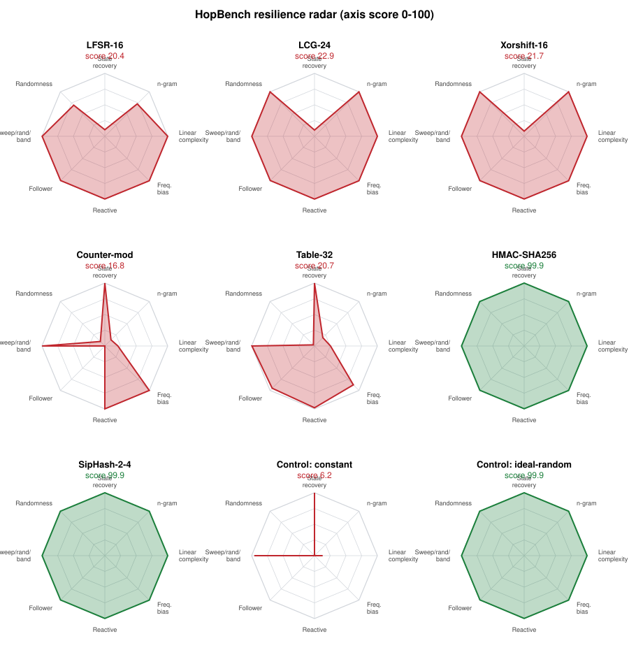

# HopBench results

Simulation and education only: no RF, no third-party systems. Every schedule and attacker below is a generic scheme implemented in this repository.
**These scores are relative to this attacker suite. They are not a security proof.** See the caveats at the bottom.

Run: M = 13 channels, 16 independent secrets per schedule, 2000 slots per attack run (first 200 slots = learning window, excluded from hit rate and throughput), randomness stream 6000 hops, p_jam = 0.95, p_clean = 0.01, seeds 1000..1015. Wall time 41 s.

## Leaderboard (built-in schedules)

| # | Schedule | Score | Verdict | State recovery | n-gram / Markov | Linear complexity (BM) | Frequency bias | Reactive jammer | Follower jammer | Sweep / random / partial-band | Randomness battery |
|---|---|---|---|---:|---:|---:|---:|---:|---:|---:|---:|
| 1 | SipHash-2-4 | **99.9** | no weakness found by this suite | 100.0 | 100.0 | 100.0 | 100.0 | 99.8 | 99.7 | 99.6 | 100.0 |
| 2 | HMAC-SHA256 | **99.9** | no weakness found by this suite | 100.0 | 100.0 | 100.0 | 100.0 | 99.8 | 99.6 | 99.6 | 100.0 |
| 3 | LCG-24 | **22.9** | broken | 9.9 | 100.0 | 100.0 | 100.0 | 99.7 | 99.5 | 99.7 | 100.0 |
| 4 | Xorshift-16 | **21.7** | broken | 8.2 | 100.0 | 100.0 | 100.0 | 99.7 | 99.6 | 99.7 | 100.0 |
| 5 | Table-32 | **20.7** | broken | 100.0 | 18.7 | 25.5 | 87.4 | 98.2 | 95.1 | 99.4 | 2.5 |
| 6 | LFSR-16 | **20.4** | broken | 10.5 | 72.9 | 100.0 | 100.0 | 99.7 | 99.5 | 99.7 | 70.0 |
| 7 | Counter-mod | **16.8** | broken | 100.0 | 13.8 | 20.8 | 100.0 | 100.0 | 0.1 | 99.8 | 10.0 |

Calibration controls (not ranked): they bound the scale. The constant-channel control should land near 0 and the ideal i.i.d. uniform control near 100.

| Control | Score | State recovery | n-gram / Markov | Linear complexity (BM) | Frequency bias | Reactive jammer | Follower jammer | Sweep / random / partial-band | Randomness battery |
|---|---:|---:|---:|---:|---:|---:|---:|---:|---:|
| Control: constant | 6.2 | 100.0 | 0.0 | 13.0 | 0.0 | 0.1 | 0.1 | 95.8 | 0.0 |
| Control: ideal-random | 99.9 | 100.0 | 100.0 | 100.0 | 100.0 | 99.8 | 99.5 | 99.6 | 100.0 |



Axis values are 0-100 (100 = nothing found). The score is the weighted mean of the axes (weights below) multiplied by a weakest-link factor, so one cheap, complete break cannot be averaged away.

## Prediction accuracy vs chance (steady state, 99 % bootstrap CI over trials)

Hit rate = fraction of slots where the attacker's guess equals the actual channel, after the learning window. Chance for a single guess is 1/M = 7.7 %. Entries in **bold** have a CI that excludes chance.

| Schedule | LFSR-16 breaker | LCG-24 recovery | Xorshift-16 breaker | n-gram / Markov | Berlekamp-Massey | Frequency-bias |
|---|---:|---:|---:|---:|---:|---:|
| LFSR-16 | **100.0 [100.0, 100.0]** | 7.5 [7.1, 8.0] | 7.8 [7.3, 8.4] | **24.5 [23.9, 24.9]** | 7.6 [7.3, 8.1] | 7.4 [7.0, 7.9] |
| LCG-24 | 7.5 [7.1, 7.9] | **100.0 [100.0, 100.0]** | 7.5 [7.2, 7.9] | 7.6 [7.3, 7.9] | 7.8 [7.4, 8.1] | 8.0 [7.5, 8.4] |
| Xorshift-16 | 7.6 [7.2, 8.1] | 7.7 [7.4, 8.1] | **100.0 [100.0, 100.0]** | 8.0 [7.7, 8.3] | 7.6 [7.2, 7.9] | 7.7 [7.5, 8.0] |
| Counter-mod | 7.9 [7.5, 8.2] | 7.5 [7.1, 8.0] | 7.6 [7.3, 7.9] | **100.0 [100.0, 100.0]** | **100.0 [100.0, 100.0]** | 0.6 [0.5, 0.7] |
| Table-32 | 7.7 [7.4, 8.0] | 7.9 [7.5, 8.3] | 7.8 [7.5, 8.2] | **99.4 [98.3, 100.0]** | **100.0 [100.0, 100.0]** | **13.2 [9.5, 16.7]** |
| HMAC-SHA256 | 7.5 [7.2, 7.8] | 7.7 [7.3, 8.0] | 7.8 [7.5, 8.2] | 7.4 [7.0, 7.7] | 7.7 [7.2, 8.2] | 7.9 [7.5, 8.3] |
| SipHash-2-4 | 7.8 [7.4, 8.2] | 7.6 [7.3, 8.0] | 7.6 [7.3, 8.1] | 7.9 [7.6, 8.1] | 7.8 [7.5, 8.2] | 7.6 [7.3, 7.9] |
| Control: constant | 7.8 [7.3, 8.3] | 7.8 [7.3, 8.3] | 7.8 [7.3, 8.3] | **100.0 [100.0, 100.0]** | **100.0 [100.0, 100.0]** | **100.0 [100.0, 100.0]** |
| Control: ideal-random | 7.6 [7.4, 7.9] | 7.5 [7.2, 7.9] | 7.4 [6.9, 7.9] | 7.9 [7.5, 8.3] | 7.6 [7.2, 8.0] | 7.8 [7.4, 8.1] |

## Hops observed before the attacker is right 16 times in a row (chance of that by luck: 13^-16)

Median over the trials where it happened, with the fraction of trials broken within 2000 slots in brackets. `-` = never.

| Schedule | LFSR-16 breaker | LCG-24 recovery | Xorshift-16 breaker | n-gram / Markov | Berlekamp-Massey | Frequency-bias |
|---|---:|---:|---:|---:|---:|---:|
| LFSR-16 | 8 (100%) | - | - | - | - | - |
| LCG-24 | - | 6 (100%) | - | - | - | - |
| Xorshift-16 | - | - | 5 (100%) | - | - | - |
| Counter-mod | - | - | - | 14 (100%) | 52 (100%) | - |
| Table-32 | - | - | - | 34 (100%) | 128 (100%) | - |
| HMAC-SHA256 | - | - | - | - | - | - |
| SipHash-2-4 | - | - | - | - | - | - |
| Control: constant | - | - | - | 1 (100%) | 12 (100%) | 1 (100%) |
| Control: ideal-random | - | - | - | - | - | - |

## Throughput under each attacker

Fraction of packets delivered after the learning window, mean over trials (worst-decile trial in brackets). One packet per slot; a packet on a jammed channel is lost with probability 0.95, otherwise with probability 0.01. Predictors jam their single guess.

| Schedule | LFSR-16 breaker | LCG-24 recovery | Xorshift-16 breaker | n-gram / Markov | Berlekamp-Massey | Frequency-bias | Reactive (delay 1) | Sweep | Random | Partial-band (4 ch) | Follower (trend, +-1) |
|---|---:|---:|---:|---:|---:|---:|---:|---:|---:|---:|---:|
| LFSR-16 | 4.9 (4.0) | 91.9 (91.1) | 91.7 (90.4) | 76.0 (74.9) | 91.7 (90.9) | 92.0 (91.0) | 91.6 (90.8) | 91.8 (90.9) | 91.7 (90.9) | 70.0 (68.9) | 77.2 (76.1) |
| LCG-24 | 91.9 (91.1) | 4.9 (4.0) | 91.9 (91.0) | 91.8 (91.1) | 91.6 (90.9) | 91.4 (90.8) | 91.7 (90.9) | 91.7 (91.1) | 91.6 (90.9) | 70.1 (69.0) | 77.3 (76.0) |
| Xorshift-16 | 91.7 (90.6) | 91.6 (91.0) | 4.9 (4.0) | 91.4 (90.7) | 91.8 (91.1) | 91.7 (91.3) | 91.8 (90.8) | 91.7 (90.7) | 91.8 (91.1) | 70.3 (68.9) | 77.5 (76.2) |
| Counter-mod | 91.5 (90.6) | 91.9 (90.9) | 91.8 (91.2) | 4.9 (4.0) | 4.9 (4.0) | 98.4 (97.9) | 98.9 (98.7) | 92.1 (91.4) | 91.7 (91.0) | 69.9 (69.5) | 4.9 (4.0) |
| Table-32 | 91.7 (91.1) | 91.6 (90.9) | 91.6 (90.9) | 5.4 (4.2) | 4.9 (4.0) | 86.6 (81.3) | 92.9 (85.6) | 91.7 (91.4) | 91.4 (90.6) | 70.2 (67.1) | 76.2 (63.6) |
| HMAC-SHA256 | 91.8 (91.3) | 91.7 (90.8) | 91.6 (90.8) | 92.0 (91.3) | 91.7 (90.4) | 91.5 (90.7) | 91.9 (91.0) | 91.7 (90.9) | 91.7 (90.4) | 70.2 (68.3) | 77.4 (76.1) |
| SipHash-2-4 | 91.6 (90.7) | 91.8 (91.0) | 91.7 (91.0) | 91.6 (90.8) | 91.6 (90.9) | 91.7 (90.7) | 91.7 (91.0) | 91.8 (91.3) | 91.6 (90.9) | 69.7 (68.6) | 77.4 (76.4) |
| Control: constant | 91.6 (90.9) | 91.6 (90.7) | 91.7 (90.9) | 4.9 (4.0) | 4.9 (4.0) | 4.9 (4.0) | 4.9 (4.0) | 91.7 (91.4) | 91.7 (90.9) | 67.1 (39.0) | 4.9 (4.0) |
| Control: ideal-random | 91.7 (91.1) | 91.9 (91.1) | 92.0 (91.1) | 91.6 (90.6) | 91.9 (91.0) | 91.7 (91.0) | 91.8 (91.1) | 91.5 (90.6) | 91.9 (91.0) | 69.9 (68.7) | 77.4 (75.9) |

Reference throughput of an ideal-random schedule for the jammers (analytic): Reactive (delay 1) 91.8, Sweep 91.8, Random 91.8, Partial-band (4 ch) 70.1, Follower (trend, +-1) 77.3.

## Jammer hit rate vs chance

| Schedule | Reactive (delay 1) (chance 7.7) | Sweep (chance 7.7) | Random (chance 7.7) | Partial-band (4 ch) (chance 30.8) | Follower (trend, +-1) (chance 23.1) |
|---|---:|---:|---:|---:|---:|
| LFSR-16 | 7.8 | 7.7 | 7.6 | 30.8 | 23.1 |
| LCG-24 | 7.7 | 7.8 | 7.8 | 30.6 | 22.9 |
| Xorshift-16 | 7.6 | 7.6 | 7.6 | 30.5 | 22.9 |
| Counter-mod | 0.0 | 7.2 | 7.8 | 30.8 | **100.0** |
| Table-32 | 6.4 | 7.7 | 8.1 | 30.6 | 24.2 |
| HMAC-SHA256 | 7.5 | 7.7 | 7.7 | 30.6 | 22.9 |
| SipHash-2-4 | 7.7 | 7.6 | 7.8 | 31.1 | 23.0 |
| Control: constant | **100.0** | 7.7 | 7.8 | 33.9 | **100.0** |
| Control: ideal-random | 7.6 | 7.9 | 7.6 | 30.9 | 22.9 |

## Randomness battery (share of trials failing each test at alpha = 0.001)

| Schedule | chi2_uniform | serial_corr_lag1 | runs | pair_chi2 | autocorr_max64 | coincidence_scan | lc_plane0 | lc_plane1 | lc_plane2 | lc_plane3 | Shannon / min-entropy (bits per hop; ideal 3.70) |
|---|---:|---:|---:|---:|---:|---:|---:|---:|---:|---:|---:|
| LFSR-16 | 0% | 100% | 0% | 100% | 100% | 0% | 0% | 0% | 0% | 0% | 3.699 / 3.589 |
| LCG-24 | 0% | 0% | 0% | 0% | 0% | 0% | 0% | 0% | 0% | 0% | 3.699 / 3.602 |
| Xorshift-16 | 0% | 0% | 0% | 0% | 0% | 0% | 0% | 0% | 0% | 0% | 3.699 / 3.599 |
| Counter-mod | 0% | 100% | 100% | 100% | 100% | 100% | 100% | 100% | 100% | 100% | 3.700 / 3.699 |
| Table-32 | 100% | 81% | 94% | 100% | 100% | 100% | 100% | 100% | 100% | 100% | 3.390 / 2.661 |
| HMAC-SHA256 | 0% | 0% | 0% | 0% | 0% | 0% | 0% | 0% | 0% | 0% | 3.699 / 3.586 |
| SipHash-2-4 | 0% | 0% | 0% | 0% | 0% | 0% | 0% | 0% | 0% | 0% | 3.699 / 3.603 |
| Control: constant | 100% | 100% | 100% | 100% | 100% | 100% | 100% | 100% | 100% | 100% | 0.000 / 0.000 |
| Control: ideal-random | 0% | 0% | 0% | 0% | 0% | 0% | 0% | 0% | 0% | 0% | 3.699 / 3.597 |

## What the numbers say (generated from the table values)

- **SipHash-2-4** (99.9): weakest axes Sweep / random / partial-band 99.6, Follower jammer 99.7. No attacker in the suite produced a sustained break.
- **HMAC-SHA256** (99.9): weakest axes Sweep / random / partial-band 99.6, Follower jammer 99.6. No attacker in the suite produced a sustained break.
- **LCG-24** (22.9): weakest axes State recovery 9.9, Follower jammer 99.5. Broken (>= 50 % of trials) by LCG-24 recovery after 6 hops.
- **Xorshift-16** (21.7): weakest axes State recovery 8.2, Follower jammer 99.6. Broken (>= 50 % of trials) by Xorshift-16 breaker after 5 hops.
- **Table-32** (20.7): weakest axes Randomness battery 2.5, n-gram / Markov 18.7. Broken (>= 50 % of trials) by n-gram / Markov after 34 hops; Berlekamp-Massey after 128 hops.
- **LFSR-16** (20.4): weakest axes State recovery 10.5, Randomness battery 70.0. Broken (>= 50 % of trials) by LFSR-16 breaker after 8 hops.
- **Counter-mod** (16.8): weakest axes Follower jammer 0.1, Randomness battery 10.0. Broken (>= 50 % of trials) by n-gram / Markov after 14 hops; Berlekamp-Massey after 52 hops.

## Scoring (summary; full derivation in README.md)

- Per attacker: `resist = 0.6 * advantage_score + 0.4 * (observations_score | throughput_score)`, advantage = log2(hit/chance)/log2(1/chance).
- Axis weights: State recovery 20, n-gram / Markov 15, Linear complexity (BM) 10, Frequency bias 10, Reactive jammer 8, Follower jammer 7, Sweep / random / partial-band 10, Randomness battery 20.
- Weakest-link gate: `score = 100 * weighted_mean * (0.2 + 0.8 * min(State recovery, n-gram / Markov, Linear complexity (BM), Frequency bias))`.

## Caveats (read these)

- Scores depend entirely on the attacker suite. A schedule with a weakness none of the 11 attackers exploits scores high. A 100 means "nothing found here", never "secure".
- Xorshift-16, LFSR-16 and LCG-24 are scored against a white-box candidate-elimination attacker written for exactly that generator. A custom generator you plug in has no such dedicated attacker, so its score is an upper bound on its real resilience.
- The threat model is generous to the attacker in one way (perfect, instant observation of every past hop, knowledge of the algorithm) and generous to the defender in others (no side channels, no key leakage, no synchronisation errors, the receiver always hears the right channel).
- Throughput is a toy model: one packet per slot, a binary jam/no-jam loss draw. It is not a link-budget or RF simulation.
- The keyed schedules (HMAC-SHA256, SipHash-2-4) score about as high as the ideal i.i.d. control. That means these attackers cannot tell them from random; it says nothing about attacks outside the suite. Their real strength rests on the cryptographic assumptions, not on this benchmark.
- Weights, the 16-in-a-row break criterion, the 200-slot learning window and the log-advantage transform are design choices. Changing them re-orders scores of mid-range schedules, though not the broken-vs-unbroken split.
- Sampling: 16 secrets per schedule gives 99 % bootstrap CIs of roughly +-0.3 to 1 percentage points on near-chance hit rates; differences smaller than that are noise. Rerun with more trials to tighten.
- The ideal control uses numpy PCG64, itself not cryptographic; it only represents i.i.d. uniform hops.

## Reproduce

```
python -m hopbench run --out results --jobs 2
```
